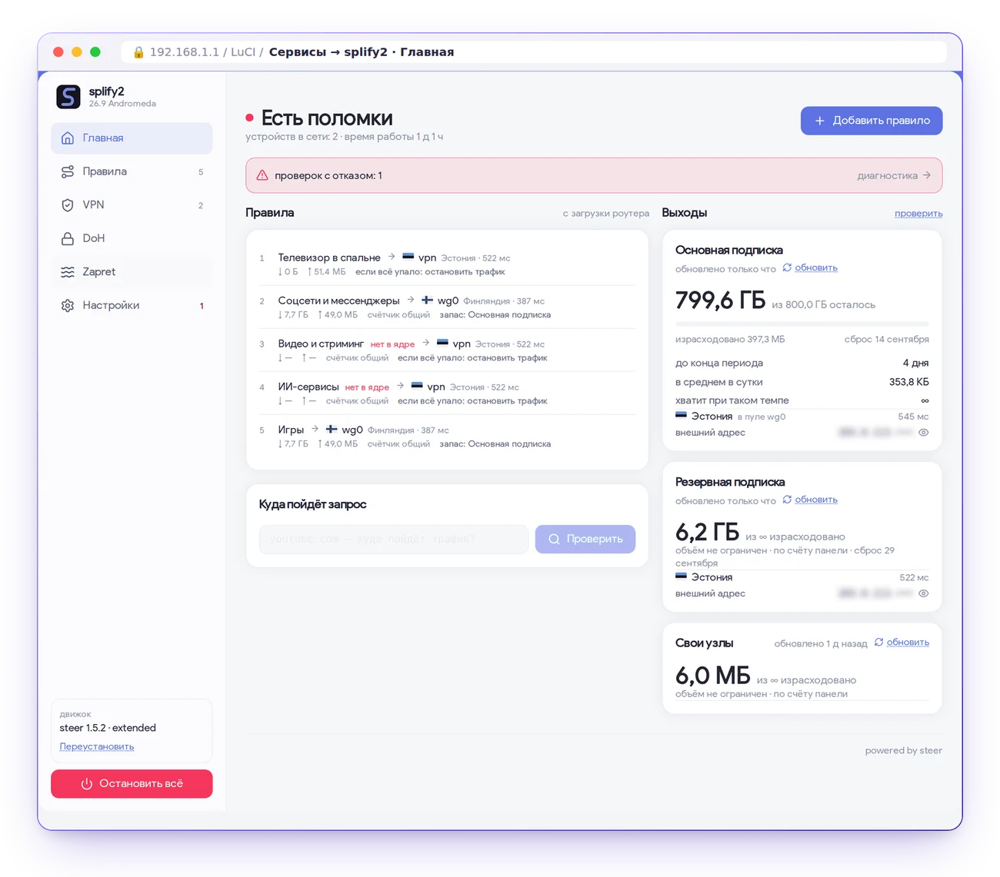
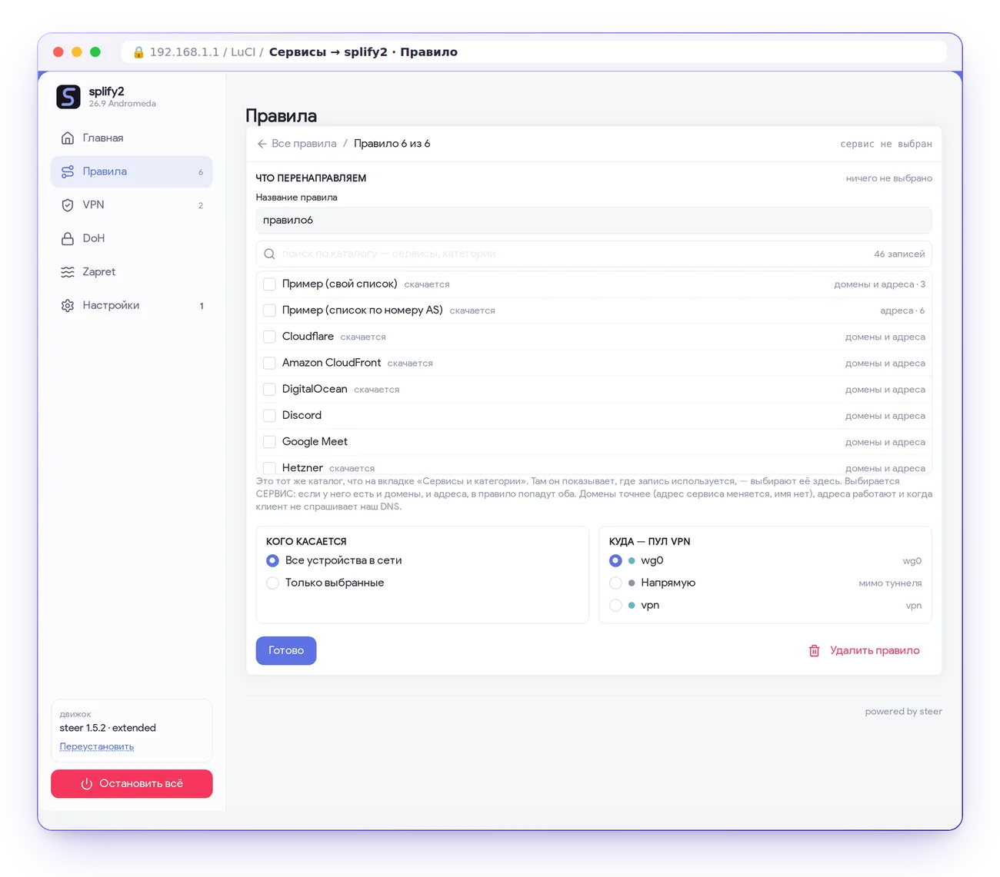
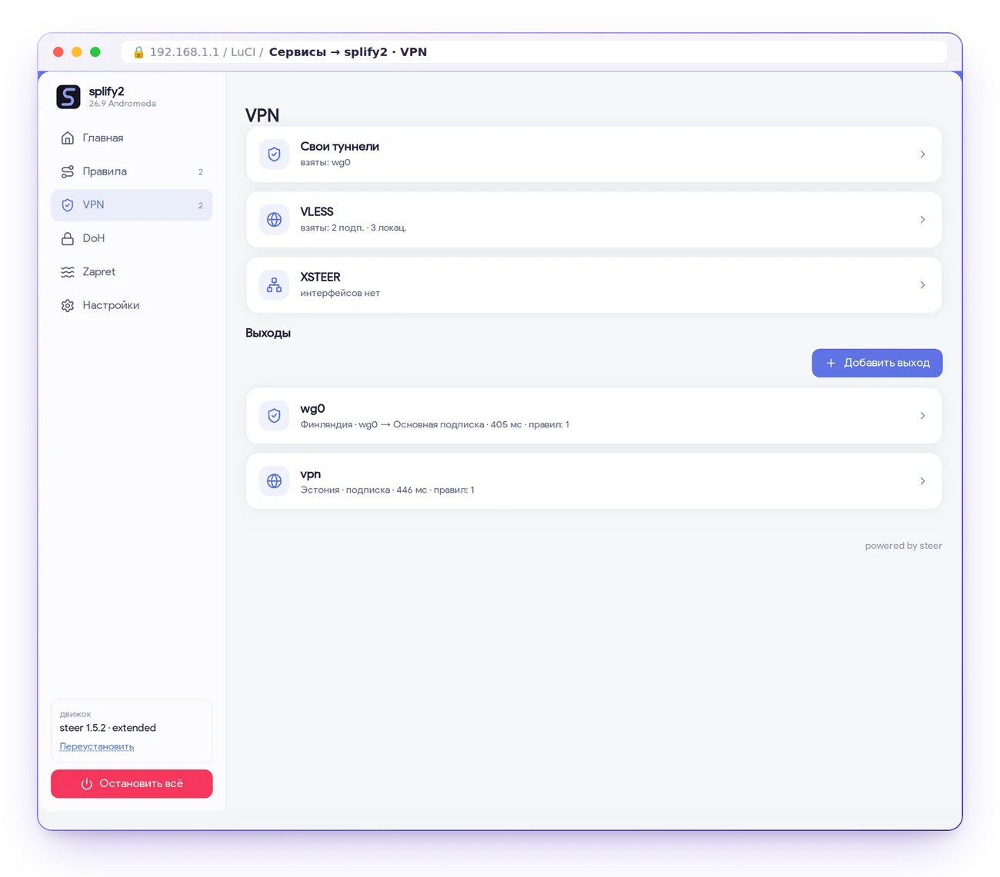
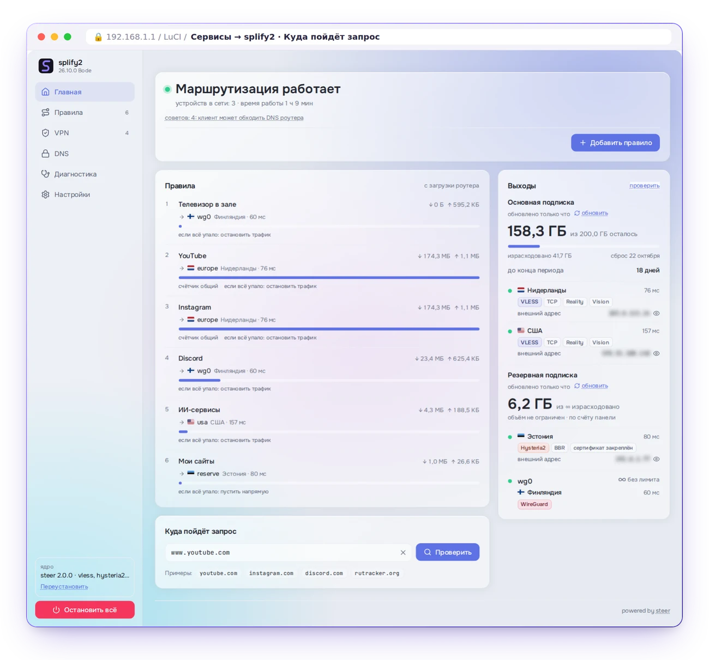
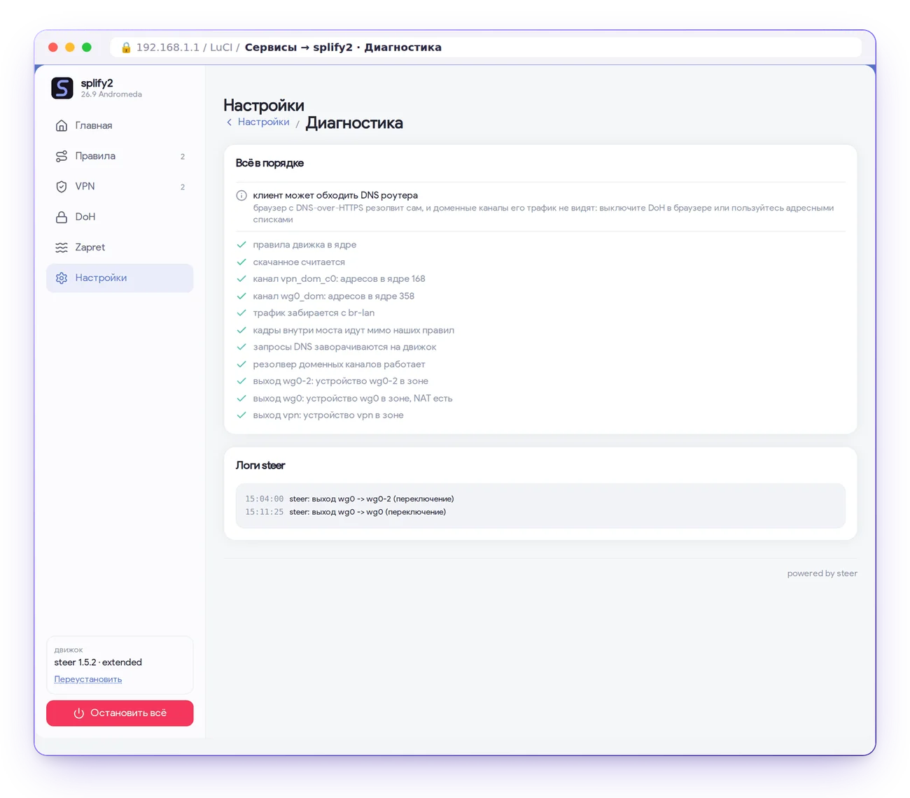

<div align="center">


# splify2

**Нужные сервисы — через туннель на всех устройствах сети. Всё остальное — напрямую.**

[](https://github.com/splify2/splify2/releases)
[](https://splify2.github.io/docs/splify2/)
[](https://t.me/ssplify)
[](https://pay.cloudtips.ru/p/fb925110)


</div>

Панель для роутера на OpenWrt — страница LuCI **Сервисы → splify2**. Вы выбираете сервисы и выход,
splify2 пишет спеку ядру [steer](https://github.com/splify2/steer), а маршрутизацию ведёт ядро steer
средствами ядра Linux: nftables, таблицы маршрутизации, домены через fake-IP.

## Возможности

- **Правила** — «что + кого касается + куда»: сервисы каталога и свои списки, вся сеть или выбранные
  устройства, выход. Читаются сверху вниз, побеждает первое совпадение
- **Выходы** — свой интерфейс роутера (WireGuard, AmneziaWG), подписки VLESS, hysteria2 и прокси
  (Trojan, Shadowsocks, SOCKS, HTTP(S), VMess), xsteer, WARP (модуль `steer-warpbox`), WireGuard поверх поддельного TCP
- **Узлы подписок** — несколько узлов сразу с раздачей соединений и слежкой, «Не брать» по странам и
  словам в имени, бейджи протокола и защиты у каждого узла, внешний адрес выхода
- **Группы** — первый живой, самый быстрый, выбор вручную, раздача по весам (случайно, сайт — на
  одном выходе, сайт и устройство — на одном выходе); упало всё — трафик останавливается, а не
  уходит мимо туннеля
- **DNS** — серверы DoH, DoT, DoQ и обычные, у правила свой сервер; несколько серверов сразу или по
  очереди и свой сервер для остальных сайтов
- **Каталог сервисов** — списки обновляются сами; при закрытом GitHub — через зеркало и запасные хосты
- **Запросы** — имена и соединения: имя → правило → выход → узел, «Почему сюда», скорость и график
  трафика по выходам
- **Диагностика** — проверки ядра, журнал; «Куда пойдёт запрос» на главной — для любого имени

<div align="center">

<picture><source media="(prefers-color-scheme: dark)" srcset="docs/img/framed/home-dark.webp"></picture>

<table><tr><td align="center" width="50%"><picture><source media="(prefers-color-scheme: dark)" srcset="docs/img/framed/editor-dark.webp"></picture><br><sub>Правило: что, кого касается, куда</sub></td><td align="center" width="50%"><picture><source media="(prefers-color-scheme: dark)" srcset="docs/img/framed/vpn-dark.webp"></picture><br><sub>Выходы и подписки</sub></td></tr><tr><td align="center"><picture><source media="(prefers-color-scheme: dark)" srcset="docs/img/framed/explain-dark.webp"></picture><br><sub>Куда пойдёт запрос</sub></td><td align="center"><picture><source media="(prefers-color-scheme: dark)" srcset="docs/img/framed/diag-dark.webp"></picture><br><sub>Диагностика</sub></td></tr></table>

</div>

## Установка

```sh
wget -O /tmp/splify2-install.sh https://gitlab.com/xyzmean/splify2/-/raw/main/install.sh && sh /tmp/splify2-install.sh
```

Установщик сам определяет архитектуру и менеджер пакетов (apk — на OpenWrt 25.12 и новее, opkg —
на 24.10 и старше) и ставит ядро steer 2.1 (`steer-core` и модули протоколов) и страницу LuCI.
Нужно ядро steer 2.1.0 или новее. Следы удаляет `splify2-purge` (без ключей показывает план, `--yes`
выполняет); сами пакеты он не снимает — это делает кнопка в «Настройки → Интерфейс» или `apk del`/`opkg remove`.

## Поддержать splify2 / Support splify2 / 支持 splify2

[Поддержать через CloudTips / Donate via CloudTips / 通过 CloudTips 捐赠](https://pay.cloudtips.ru/p/fb925110)

<details>
<summary>Донаты в криптовалюте / Crypto donations / 加密货币捐赠</summary>

| Bitcoin (BTC) / 比特币 | TON / USDT (TON) | ETH (Ethereum / 以太坊) |
| :---: | :---: | :---: |
|  |  |  |

- **Bitcoin / 比特币:** `bc1q0d2j8zgrfnr33j83y9hza3mk0py8xtpzg5wxxv`
- **Сеть TON / TON network / TON 网络:** `UQA_zsyjS1uVC4r0aGfCiY6skZvMsqeeUb7K425eq42KYVai`
- **Только ETH в сети Ethereum / ETH on Ethereum only / 仅限以太坊网络的 ETH:** `0xD6dc71Eba770A4527a94FBa9D369cf6f2B2CFB15`

- **Русский:** Для адреса TON выберите в кошельке Toncoin (TON) или USDT перед отправкой. Для USDT используйте сеть TON, а не Ethereum или Tron.
- **English:** For the TON address, select Toncoin (TON) or USDT in your wallet before sending. Use the TON network for USDT, not Ethereum or Tron.
- **简体中文：** 向 TON 地址转账前，请在钱包中选择 Toncoin（TON）或 USDT。发送 USDT 时请选择 TON 网络，不要使用 Ethereum 或 Tron 网络。

</details>

## Документация

- [Быстрый старт](https://splify2.github.io/docs/quickstart/) и [как это работает](https://splify2.github.io/docs/how-it-works/)
- [Панель splify2 подробно](https://splify2.github.io/docs/splify2/) — [docs/guide.md](docs/guide.md)
- [API rpcd](https://splify2.github.io/docs/splify2/rpcd-api/) — методы бэкенда
- [Ядро steer](https://splify2.github.io/docs/steer/) и [каталог списков](https://github.com/splify2/splify2-lists)
